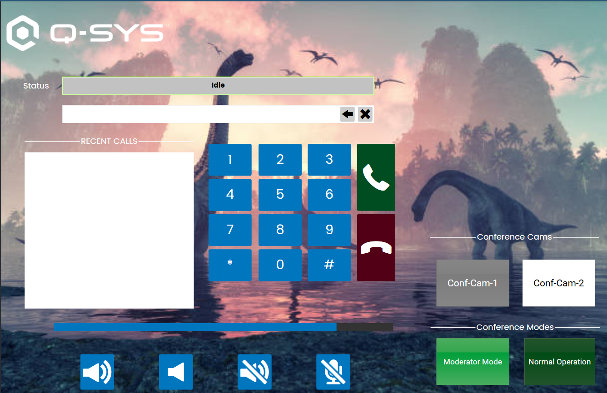
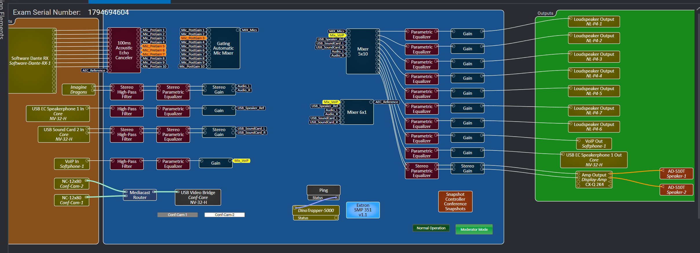
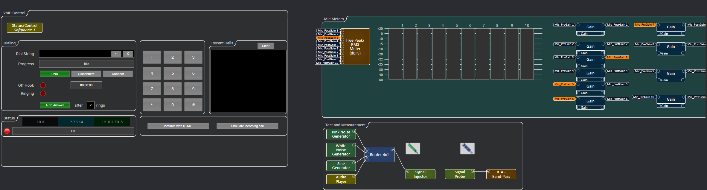
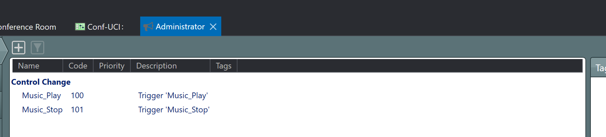
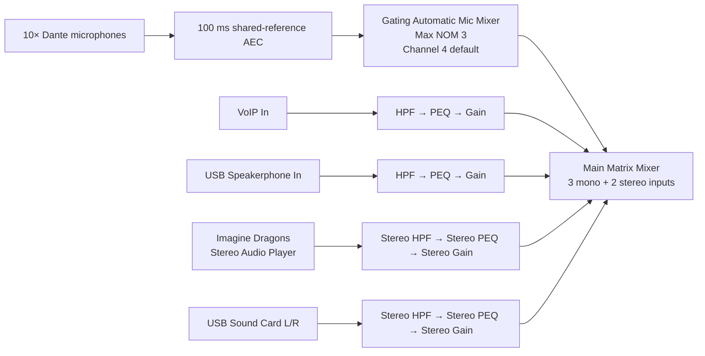
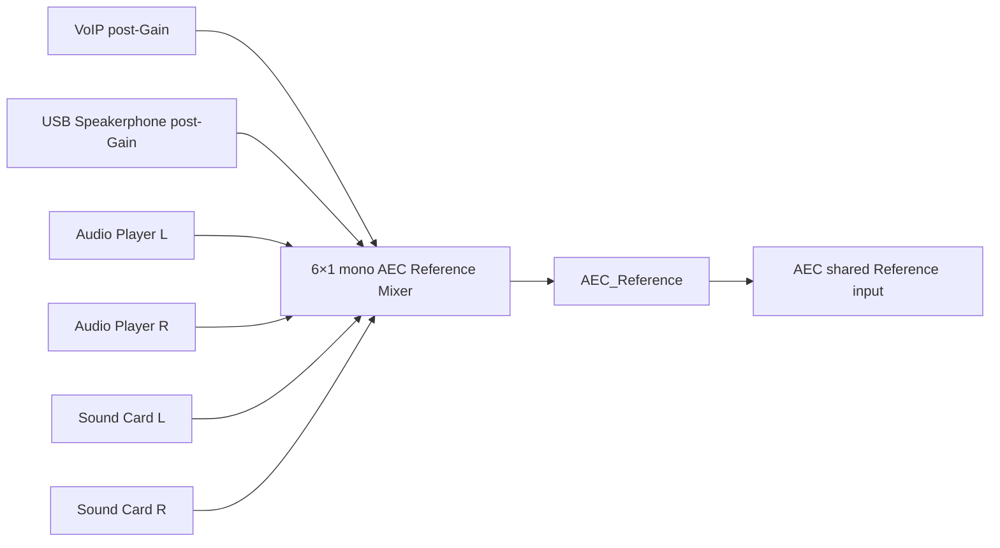
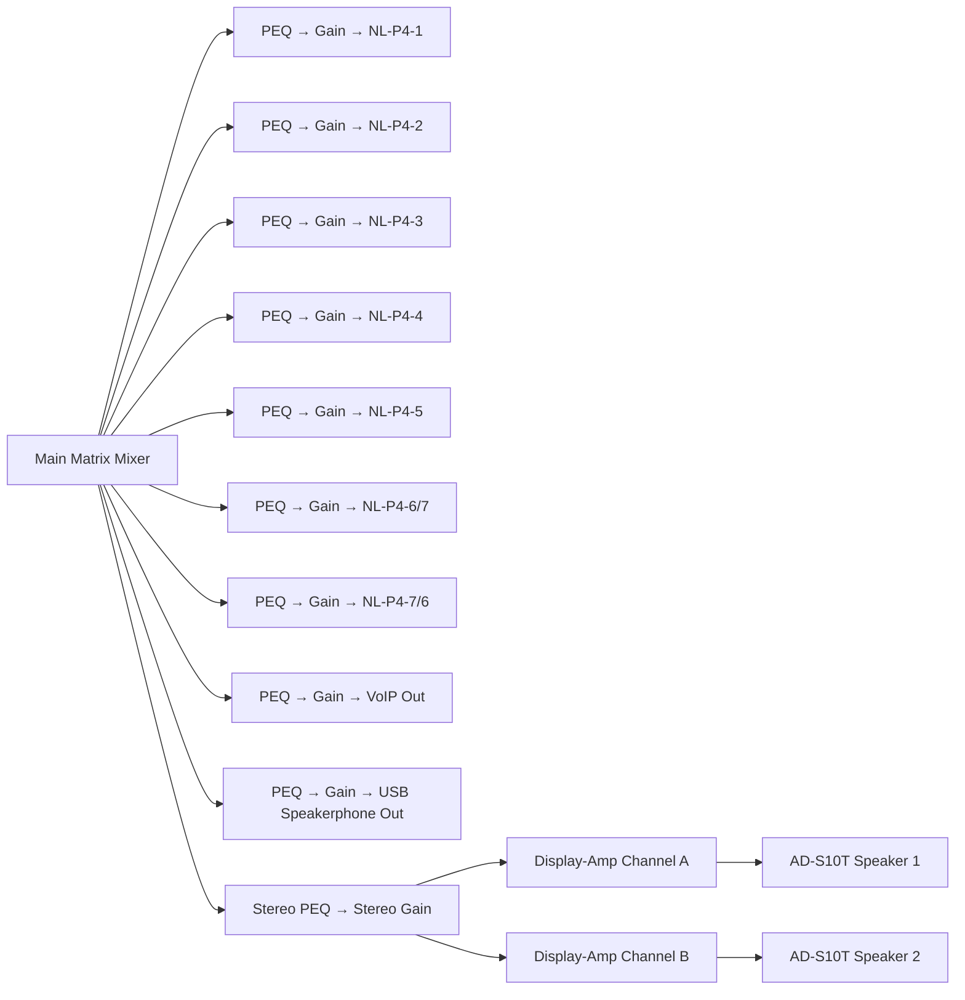

# Q-SYS Conference Room

A single-room conferencing system in Q-SYS Designer: ten-mic speech processing, program and call audio, two-camera switching, and a touchpanel with two operating modes.










An **NV-32-H** core named `Conf-Core` runs the room. All inventory items are located in `Conf-Room`.

## Audio

Ten Dante microphones enter a shared-reference **100 ms Acoustic Echo Canceler** and then a **Gating Automatic Mic Mixer**. The GAMM is limited to three open microphones, with Channel 4 configured as the default microphone.

A ten-channel True Peak/RMS meter and ten dedicated gain controls monitor the microphone paths.

### Main audio inputs

Each non-microphone input has its own High-Pass Filter, Parametric Equalizer, and Gain:

| Matrix input | Source | Type |
|---|---|---|
| 1 | `MIX_Mics` from GAMM | Mono |
| 2 | `Mix_VoIP` from VoIP processing | Mono |
| 3 | USB Speakerphone input | Mono |
| 4 | `Imagine Dragons` Audio Player | Stereo |
| 5 | USB Sound Card left/right | Stereo |

The required Audio Player is configured with **2 tracks**, is stereo, playlist-capable, and uses the playlist `Imagine Dragons`. A separate one-track Audio Player remains isolated in the Test and Measurement section.



### AEC Reference mix

All non-microphone sources that can play through the room loudspeakers are also summed into a dedicated six-input reference mixer:



The microphone mix is excluded from the AEC Reference path. The obsolete `Mixer 2x1 → AEC Ref` branch was removed.

## Outputs

The main Matrix Mixer is configured with:

```text
Inputs:  3 mono + 2 stereo
Outputs: 9 mono + 1 stereo
```

Outputs feed seven NL-P4 loudspeakers, VoIP and USB returns, and the display amplifier. Each output has its own Parametric Equalizer and Gain component.



The CX-Q 2K4 amplifier is named `Display-Amp`. Its stereo input uses Channels A and B, and the two AD-S10T loudspeakers are connected to amplifier outputs A and B. Channels C and D are unused.

The Matrix control panel is labeled to match the schematic. Active crosspoints use `0 dB`; inactive crosspoints use `-100 dB`. The Display-Amp stereo output contains all five main audio inputs.

## Video and control

Two **NC-12x80** cameras named `Conf-Cam-1` and `Conf-Cam-2` feed a Mediacast Router. The selected camera is routed to the Core USB Video Bridge and displayed through the touchpanel.

`Conf-UCI` is configured for a **TSC-101-G3** controller. Camera buttons directly control the Mediacast Router.

The `Conference Snapshots` bank provides two operating modes:

| Mode | Mic state |
|---|---|
| Moderator | Channel 1 manual and open; channels 2–10 muted |
| Normal | All ten channels gating and unmuted; Channel 4 default |

On weekdays, named controls operate the Audio Player automatically:

```text
17:00 → Music_Play
21:00 → Music_Stop
```

## Monitoring and testing

A Ping component reports the status of `DinoTrapper-5000` through a Monitoring Proxy configured as:

```text
Manufacturer: TriceraTraps, Inc.
Type: CaptureDevice
Location: Conf-Room
```

The Test and Measurement section remains separate from the conference-room signal flow and includes its own test Audio Player, Router 4×1, Signal Injector, Signal Probe, and RTA Band-Pass components.

## Skills demonstrated

- Q-SYS core and inventory configuration
- Shared-reference AEC processing
- NOM-limited automatic mic mixing
- Per-input and per-output EQ and Gain processing
- Mono/stereo Matrix Mixer routing
- AEC Reference mixing
- Direct wires, signal tags, and signal snakes
- UCI camera control
- Snapshot-based room modes
- Named controls and scheduling
- Monitoring Proxy and Ping status reporting

Design file: `Conference Room Project.qsys`