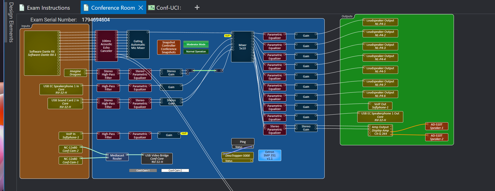
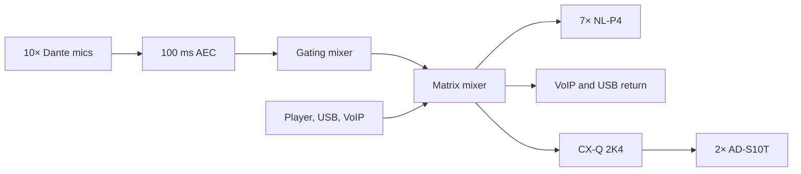

# Q-SYS Conference Room

A single-room conferencing system in Q-SYS Designer: ten-mic speech processing, program and call audio, two-camera switching, and a touchpanel with two operating modes.

An **NV-32-H** (`Conf-Core`) runs the room. Every inventory item is located in `Conf-Room`.

## Audio

Ten Dante microphones pass through a shared-reference **100 ms acoustic echo canceler**, then a **gating automatic mic mixer** capped at three open mics. Channel 4 stays the default open mic. A ten-channel true-peak/RMS meter sits on the mic path.

Program and far-end sources each have their own high-pass, parametric EQ, and gain before a **5×10 matrix mixer**:

- Stereo audio player, playlist `Imagine Dragons`
- USB speakerphone
- USB sound card
- VoIP

Matrix outputs feed seven **NL-P4** ceiling speakers, VoIP and USB return, and a **CX-Q 2K4** (`Display-Amp`) driving two **AD-S10T** speakers. Each destination has its own EQ and gain.

## Video and control

Two **NC-12x80** cameras (`Conf-Cam-1`, `Conf-Cam-2`) feed a Mediacast Router. The router sends the selected camera to the core USB video bridge and to the touchpanel.

**Conf-UCI** is built for a **TSC-101-G3**. Camera buttons drive the router directly. Two room modes are stored in the snapshot bank `Conference Snapshots` and recalled from the panel:

| Mode | Mic state |
|---|---|
| Moderator | Channel 1 manual and open; channels 2–10 muted |
| Normal | All ten channels gating and unmuted; channel 4 default |

On weekdays the audio player starts at 17:00 (`Music_Play`) and stops at 21:00 (`Music_Stop`) through named controls and a weekly scheduler.

A ping to `192.168.112.117` reports status for a monitored capture device, the **DinoTrapper-5000** (TriceraTraps, Inc.), also located in `Conf-Room`.

## Skills

- Full Q-SYS design: core, inventory, DSP, video routing, UCI, and peripherals in one file
- Conferencing DSP with shared-reference AEC, NOM-limited gating, and per-path EQ and gain
- Control with snapshots, named controls, and a scheduler
- Signal wiring with direct wires, signal tags, and signal snakes
- Device monitoring through a status proxy

Design file: `Q-SYS Level One Exit Exam v8_26_EN4.qsys`
